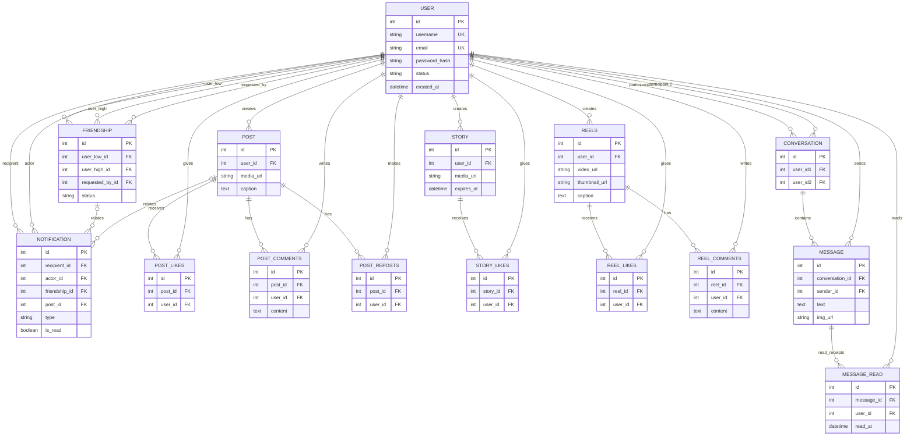

# Story

Story는 Flask로 만든 소셜 미디어 웹 애플리케이션입니다. 사용자는 계정을 만들고 서로 연결해 게시물과 짧은 스토리를 공유하고, 릴스 영상을 보고, 댓글과 좋아요를 주고받으며 1:1 메시지를 보낼 수 있습니다.

## 주요 기능

- **회원 및 프로필**: 가입, 로그인, 계정 정보 찾기, 프로필 수정, 계정 비활성화 및 삭제 요청
- **친구 관계**: 친구 요청과 수락, 관계 상태 관리
- **게시물**: 이미지 게시, 수정 및 삭제, 댓글, 좋아요, 리포스트
- **스토리**: 미디어와 문구를 포함한 스토리 생성·수정·삭제, 좋아요, 만료 시각 관리
- **릴스**: 짧은 영상 업로드, 썸네일 및 설명 관리, 댓글과 좋아요
- **다이렉트 메시지**: 두 사용자 간 대화, 이미지 메시지, 읽음 표시
- **알림과 접속 상태**: 친구 요청 및 게시물 반응 알림, 선택적 Redis 기반 온라인 상태와 Socket.IO 이벤트
- **검색**: 앱의 사용자 및 콘텐츠 탐색 화면

## 구현 개요

### 애플리케이션 구조

- `story/__init__.py`의 `create_app()`이 Flask 앱을 만들고 설정, SQLAlchemy, Flask-Migrate, Flask-Login, CSRF, 템플릿 필터와 Blueprint를 초기화합니다.
- 기능별 Blueprint가 인증·프로필, 게시물, 스토리, 릴스, 검색, 메시지 요청을 처리합니다. HTML 화면은 Jinja 템플릿을 사용하고, 일부 상호작용은 JSON 응답과 브라우저 JavaScript로 갱신합니다.
- 계정이 필요한 화면은 요청 전 로그인 상태를 확인합니다. 비밀번호는 해시로 저장되며, `SECRET_KEY`는 세션과 CSRF 보호에 사용됩니다.
- `story/events.py`의 Flask-SocketIO 핸들러가 메시지 송수신, 읽음 상태와 presence 이벤트를 처리합니다. 컨테이너는 threading 모드와 Gunicorn `gthread` 워커, `simple-websocket`을 사용합니다.

### 데이터와 미디어

- SQLAlchemy 모델은 사용자, 친구 관계, 알림, 게시물, 스토리, 릴스, 대화와 메시지 데이터를 관리합니다. 중복 좋아요·리포스트·읽음 항목 등을 막기 위해 고유 제약 조건을 둡니다.
- 기본 데이터베이스는 SQLite이며, `DATABASE_URL`을 설정하면 PostgreSQL 등을 사용할 수 있습니다. 앱 시작 시 테이블을 생성하고 일부 기존 스키마 호환 처리를 수행합니다. 버전이 관리되는 마이그레이션은 `migrations/`에 있습니다.
- 업로드 미디어는 기본 개발 환경에서 `story/static/` 아래에 저장됩니다. Supabase Storage 설정을 제공하면 이미지와 영상은 원격 버킷에 저장되고 DB에는 `sb:` 참조가 기록됩니다.
- 컨테이너 파일 시스템은 임시이므로 운영 배포에서는 영속 데이터베이스와 영속 미디어 저장소를 설정해야 합니다.

## 데이터베이스 ER 다이어그램

아래는 핵심 테이블과 외래 키 관계입니다. `User`와 같은 사용자 행이 여러 역할(작성자, 수신자, 발신자)을 맡는 테이블은 관계 끝에 역할을 표시했습니다.



좋아요, 댓글, 리포스트, 읽음 표시는 사용자와 대상 사이의 연결 테이블로 표현합니다. 친구 관계는 사용자 쌍을 정렬해 한 쌍당 하나의 관계로 저장하며, 요청자와 `pending`/`accepted` 상태를 기록합니다. 스토리 좋아요 모델에는 별도의 사용자-스토리 고유 제약이 정의되어 있지 않습니다.

## 프로젝트 구조

```text
.
├── dockerfile                 # Python 이미지, 시스템 패키지, Gunicorn 실행 설정
├── requirements.txt           # Python 패키지 버전
├── render.yaml                # Render 웹 서비스 및 PostgreSQL 설정
├── config.py                  # Flask 및 기본 DB 설정
├── migrations/                # Flask-Migrate/Alembic 마이그레이션
├── seed.py                    # 개발용 데이터 준비 스크립트
├── fix_db.py                  # DB 보정 유틸리티
└── story/
    ├── __init__.py            # 앱 팩토리, 확장 초기화, 인증 요청 처리
    ├── models.py              # SQLAlchemy 데이터 모델
    ├── events.py              # Socket.IO 메시지와 presence 이벤트
    ├── media_storage.py       # 로컬 및 Supabase 미디어 저장
    ├── forms.py               # WTForms 폼
    ├── time_utils.py          # 시간대/시간 포맷 유틸리티
    ├── views/                 # 인증, DM, 게시물, 릴스, 검색, 스토리 Blueprint
    ├── templates/             # Jinja HTML 템플릿
    └── static/                # CSS, 이미지, 업로드 및 시드 미디어
```

## 실행 방법

### 사전 준비

- 로컬 실행: Python 3.12
- 컨테이너 실행: Docker
- PostgreSQL과 Redis는 선택 사항입니다. 기본 SQLite로 시작할 수 있습니다.

### Docker 실행

저장소 루트(`README.md`, `dockerfile`, `requirements.txt`가 있는 폴더)에서 이미지를 빌드하고 실행합니다.

```bash
docker build -t story-app -f dockerfile .
docker run --rm -p 5000:5000 `
  -e SECRET_KEY="replace-with-a-long-random-secret" `
  -e PORT=5000 `
  story-app
```

위 `docker run` 줄바꿈 문법은 PowerShell용입니다. macOS/Linux에서는 다음처럼 한 줄로 실행할 수 있습니다.

```bash
docker run --rm -p 5000:5000 -e SECRET_KEY="replace-with-a-long-random-secret" -e PORT=5000 story-app
```

브라우저에서 <http://localhost:5000>을 엽니다. 컨테이너는 Gunicorn `gthread` 워커 하나와 스레드 100개로 실행하며, `PORT`가 없으면 `5000`을 사용합니다. 컨테이너를 삭제하면 기본 SQLite 데이터베이스와 로컬 업로드 파일도 보존되지 않습니다.

### 로컬 개발 실행

저장소 루트에서 가상 환경을 만들고 의존성을 설치합니다.

```powershell
py -3.12 -m venv .venv
.\.venv\Scripts\Activate.ps1
python -m pip install -r requirements.txt
$env:SECRET_KEY = "local-development-secret"
flask --app story:create_app run --host 127.0.0.1 --port 5000
```

macOS/Linux에서는 가상 환경 활성화와 환경 변수 설정을 다음처럼 바꿉니다.

```bash
python3.12 -m venv .venv
source .venv/bin/activate
python -m pip install -r requirements.txt
export SECRET_KEY="local-development-secret"
flask --app story:create_app run --host 127.0.0.1 --port 5000
```

Flask 개발 서버는 로컬 개발용입니다. 배포나 Socket.IO의 Gunicorn 실행 구성이 필요하면 Dockerfile의 실행 설정을 사용하세요.

### 환경 변수

| 변수 | 설명 |
| --- | --- |
| `SECRET_KEY` | Flask 세션 및 CSRF 서명에 사용합니다. 배포에서는 반드시 충분히 무작위인 비밀값을 설정하세요. |
| `DATABASE_URL` | DB 연결 URL입니다. 미설정 시 SQLite를 사용합니다. PostgreSQL URL은 `postgresql://...` 또는 `postgres://...` 형식도 처리합니다. |
| `REDIS_URL` | 선택 항목입니다. Socket.IO 메시지 큐 및 접속 상태에 사용합니다. 기본값은 `redis://localhost:6379/0`이며 연결할 수 없을 때 앱은 Redis 없이 시작합니다. |
| `PORT` | HTTP 서버 포트입니다. 기본값은 `5000`입니다. |
| `SUPABASE_URL` | 선택 항목입니다. Supabase Storage 사용 시 프로젝트 URL을 설정합니다. |
| `SUPABASE_SECRET_KEY` 또는 `SUPABASE_SERVICE_ROLE_KEY` | Supabase Storage 업로드용 서버 비밀 키입니다. 둘 중 하나를 설정하며 공개 클라이언트에 노출하지 마세요. |
| `SUPABASE_STORAGE_BUCKET` | Supabase Storage 버킷 이름입니다. 기본값은 `story-media`입니다. |

Supabase Storage를 사용할 때는 `SUPABASE_URL`과 비밀 키를 함께 설정해야 합니다. Render에서는 앱의 로컬 업로드 파일이 재배포/재시작 후 유지되지 않으므로, 영속 미디어 저장소를 구성하세요.

## 배포 참고

저장소의 `render.yaml`은 Docker 기반 웹 서비스와 PostgreSQL 데이터베이스를 정의합니다. Render 대시보드 또는 Blueprint 배포 시 서비스에 `SECRET_KEY` 생성과 DB 연결 URL 설정을 제공하도록 작성되어 있습니다. 영속 업로드가 필요하면 Render 환경 변수에 Supabase Storage 설정도 추가해야 합니다. 비밀 키는 저장소에 직접 커밋하지 말고 호스팅 서비스의 환경 변수로 관리하세요.

## 개발 참고

- 의존성은 `requirements.txt`에서 고정 버전으로 관리합니다.
- 기본 앱 시작 과정에서 DB 테이블을 생성하고 일부 구버전 SQLite/PostgreSQL 스키마를 보정합니다. 정식 스키마 변경에는 `migrations/`의 마이그레이션을 함께 유지하세요.
- `seed.py`는 개발용 시드 데이터를 준비하는 스크립트입니다. 실행 옵션은 스크립트 도움말 또는 내용을 확인한 뒤 사용하세요.
